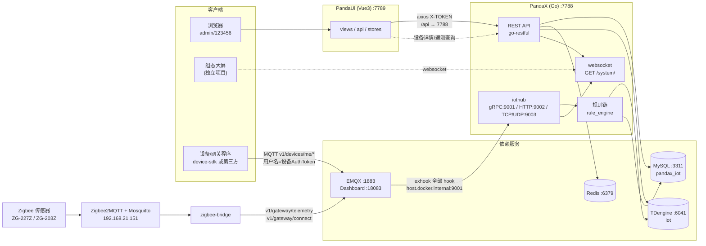
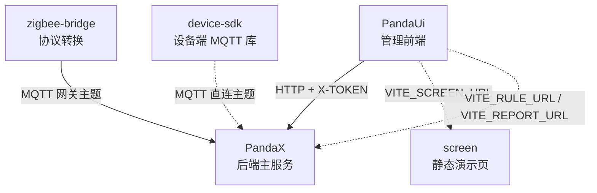
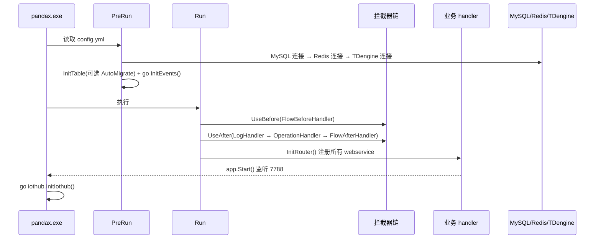
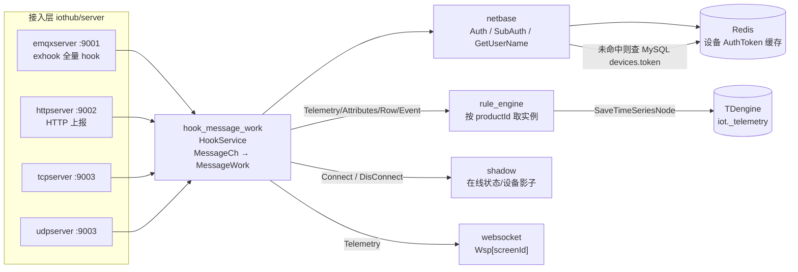
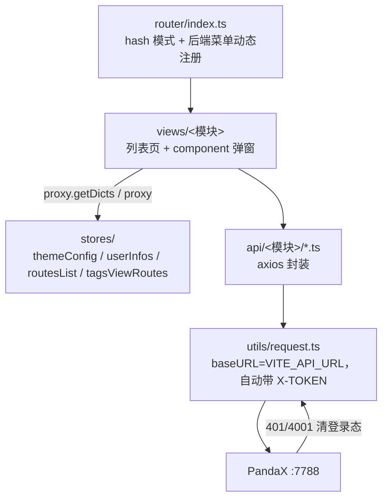
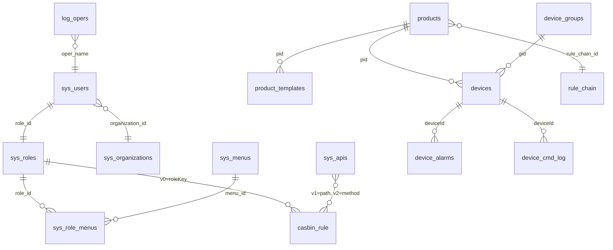
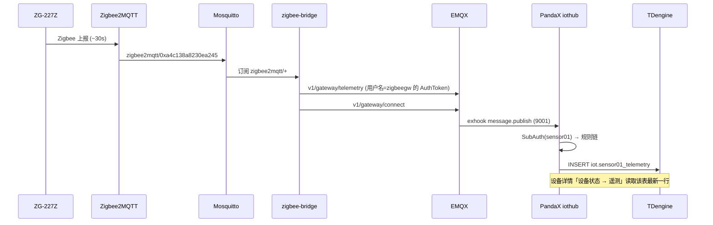

# Panda 项目结构联系图

> 本文件位于 PandaX 仓库 `docs/` 下，随代码版本管理。文中 `PandaX/`、`PandaUi/`、`zigbee-bridge/` 等指工作区中的同级目录。

说明各子项目、运行组件、PandaX 内部模块与数据存储之间的关系。所有端口与路径均以当前仓库代码/`config.yml` 为准。

---

## 1. 全局视图



ASCII 版（便于终端查看）：

```
浏览器 ──> PandaUi(7789) ──/api 代理──> PandaX REST(7788) ──> MySQL / Redis
                                              │
                                              ├──> TDengine(6041) 时序数据
                                              └──> websocket GET /system/ ──> 组态大屏

Zigbee 传感器 ──> Z2M ──> zigbee-bridge ──> EMQX(1883) ──exhook:9001──> iothub ──> 规则链 ──> TDengine
```

---

## 2. 子项目关系



| 子项目 | 角色 | 是否可独立启动 | 被谁使用 |
|---|---|---|---|
| `PandaX` | 服务端：API + 设备接入 + 规则引擎 | 是（`pandax.exe`） | PandaUi、设备、桥接 |
| `PandaUi` | 管理界面 | 是（`npm run dev`） | 人 |
| `device-sdk` | 设备端库：封装主题/报文/重连 | 否（只能被 import） | 用户自研设备程序 |
| `zigbee-bridge` | 把 Z2M 报文转成 PandaX 网关主题 | 是 | 无（独立运行） |
| `screen` | 大屏静态占位页 | 是（静态服务器） | PandaUi 菜单跳转 |

关键点：**PandaX 不依赖 device-sdk**（`go.mod` 中无此模块），二者是同一套 MQTT 协议的两端实现。

---

## 3. PandaX 启动与请求管线



单个请求的处理顺序：

```
go-restful Filter: EscapeHTML → Cors → OPTIONSFilter → Rate
        │
        ▼
FlowBeforeHandler ── 记录「请求接入」→ 调用 PermissionHandler(JWT + casbin)
        │                └─ 记录「鉴权校验」OK/FAIL
        ▼
业务 handler (ReqCtx.Handle)  ── panic 收敛为 rc.Err，写统一响应
        │
        ▼
LogHandler → OperationHandler(落 log_opers + 渲染流程图) → FlowAfterHandler(兜底打印/清理)
```

---

## 4. iothub 数据流



要点：

- EMQX 的 hook 回调地址由 `deploy/emqx-exhook.conf` 指定为 `http://host.docker.internal:9001`，**容器重建后需重新 `emqx ctl conf load`**。
- 认证在 `OnClientAuthenticate`：用户名必须命中 `devices.token`（或 `config.yml` 的 `mqtt.username`），否则 `Not authorized`。
- 消息进入 `HookService.MessageCh`，由 `MessageWork` 单协程消费（并发受 `queue` 配置限制）。
- 规则链实例按 **productId** 缓存；`InitEvents` 监听 `ProductChainRuleEvent`，规则链变更后重建实例并刷新所有绑定产品。
- 遥测会同时推给 websocket 大屏（`{"MESSAGETYPE":"01","MESSAGECONTENT":{"twinId":设备ID,"attrs":{...}}}`），PandaUi 本身不使用该通道。

规则链节点（`pkg/rule_engine/nodes`）分四类：

| 类别 | 节点 |
|---|---|
| 输入 | `InputNode` |
| 过滤/分支 | `MessageTypeSwitchNode`、`SwitchNode`、`ScriptNode`、`DeviceTypeSwitchNode` |
| 动作 | `SaveTimeSeriesNode`、`SaveAttributesNode`、`CreateAlarmNode`、`ClearAlarmNode`、`DelayNode`、`LogNode`、`RpcRequestToDeviceNode` |
| 外部/转换 | `MqttNode`、`KafkaNode`、`NatsNode`、`RestApiNode`、`RuleChainNode`、`DingNode`、`EmailNode`、`SmsNode`、`WechatNode`、`ScriptTransformNode`、`RenameKeyNode`、`DeleteKeyNode` |

---

## 5. PandaUi 内部结构



- 菜单与按钮权限来自后端（`/system/user/auth`），前端不写死路由树。
- 字典统一走 `proxy.getDicts(type)` + `proxy.selectDictLabel()`。
- dev 环境下 vite 把 `/api` 代理到 `127.0.0.1:7788`，同时 `VITE_API_URL` 直接指向 7788（两套都可用）。

---

## 6. 数据模型关系



TDengine（库 `iot`）：

| 表 | 说明 |
|---|---|
| `<productId>_telemetry` / `<productId>_attributes` | 产品级超级表（建产品时创建） |
| `<deviceName>_telemetry` / `<deviceName>_attributes` | 设备子表（建设备时创建，名称小写） |
| `events` | 设备上下线、事件上报（`CreateEventTable`） |
| `logs` / `rule_debug_*` | 规则链调试与运行日志 |

MySQL、`log_opers` 的 `trace_id` / `flow` / `flow_data` / `error_msg` 为链路图功能新增字段，改结构时务必同步 `PandaX/resource/pandax_iot.sql`。

---

## 7. 设备接入实例（Zigbee 温湿度）



---

## 8. 端口与依赖

| 组件 | 端口 | 配置位置 |
|---|---|---|
| PandaX REST | 7788 | `config.yml: server.port` |
| EMQX exhook gRPC | 9001 | `server.grpc-port` |
| iothub HTTP hook | 9002 | `server.http-port` |
| iothub TCP / UDP | 9003 | `server.tcp-port`（UDP 复用该端口） |
| PandaUi dev | 7789 | `PandaUi/.env: VITE_PORT` |
| EMQX MQTT / Dashboard | 1883 / 18083 | 容器 |
| MySQL | 3311 → 3306 | 容器映射（本机 3306 被占用） |
| Redis | 6379 | 容器 |
| TDengine REST | 6041 | 容器 |

---

## 9. 目录速查

```
Panda/                     （工作区根，非 git 仓库）
├── PandaX/                后端：apps(业务四层) / pkg(通用能力) / iothub(接入) / resource(SQL)
│   └── docs/              本文档与工作区总览（workspace.md）
├── PandaUi/               前端：src/{api,views,router,stores,utils}
├── device-sdk/            设备端 MQTT 库（client / spec / samples）
├── zigbee-bridge/         Z2M → PandaX 转换器
└── screen/                大屏静态演示页
```

各子项目的详细约定见其仓库内的 `AGENTS.md`；工作区总览见 [workspace.md](workspace.md)。
